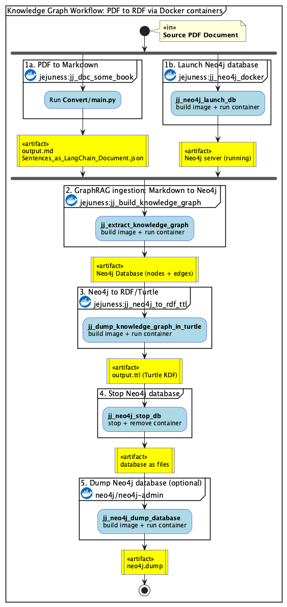

# jejune_cli<!-- omit in toc -->

## Table of content<!-- omit in toc -->

- [Introduction](#introduction)
- [Roles](#roles)
- [Installing jejune\_cli](#installing-jejune_cli)
- [Commands for all roles](#commands-for-all-roles)
- [Doc-steward commands](#doc-steward-commands)
- [Catalog Curator commands](#catalog-curator-commands)
- [Deployer commands](#deployer-commands)
- [Development](#development)
- [Notes and warnings](#notes-and-warnings)

## Introduction

`jejune_cli` groups commands by **role** — the active role is inferred from the
current directory, or forced via the `JEJUNE_ROLE` env var.
The `--help` output and `jejune doctor` checks are filtered to the detected role.

```text
# For all roles
jejune doctor            # overall workspace health check
jejune init              # role-aware workspace initialization
jejune configuration     # manage the .jejune/ configuration
jejune role              # show or list roles
jejune containers        # manage jejune-managed Docker containers

# Doc-steward  (inferred from .jejune/)
jejune neo4j             # manage the Neo4j instance
jejune llm               # manage the LLM inference server
jejune llm-observability # manage the LLM observability backend
jejune graph             # build and export the knowledge graph
jejune convert           # convert documents via Docker

# Catalog Curator  (inferred from catalog.yaml in a git repository with a jejune_catalog remote)
jejune converters        # build and test the converter images across the catalog

# Deployer  (inferred from docker-compose.yml)
jejune deployment        # manage deployments
```

### Testing pdf-to-markdown changes against the catalog

By default a converter image clones its `jejune_doc_*` from GitHub and uses the
pdf-to-markdown version locked in the `uv.lock` of the document. To check a local
pdf-to-markdown against every document, without pushing anything, **first commit
the change locally in pdf-to-markdown (do not push)**: the version of pdf-to-markdown
then carries the git commit (e.g. `0.1.1.dev41+gf6691d12d`), which identifies exactly
what was tested; uncommitted changes only add a date to the version. A rejected local
commit costs nothing (`git reset`): GitHub never sees it.

```sh
jejune converters build --local-pdf-to-markdown   # or --local-documents, or --local for both
jejune converters test --local-pdf-to-markdown    # same flags: tests those images, building the missing ones
```

pdf-to-markdown and the documents are looked for in `$JEJUNE_ROOT_DIR` (or `--root-dir`),
then in `.jejune/tmp` (pdf-to-markdown is cloned there when found nowhere, with its
whole git history: the commit count is part of its version; a checkout of
`$JEJUNE_ROOT_DIR` is never touched).
`converters test` accepts the same `--local*` flags as `converters build`: it tests the
images built with those sources, building first (with the same flags) those that do not
exist yet. Its report shows which sources each image was built with; without any flag it
tests the default images (`document: git, pdf-to-markdown: locked`).

pdf-to-markdown is a repository registered with the ecosystem (by the `converters`
component, and by the `convert` component when the document of `CONVERT_DOC_DIR` offers a
`Convert/main.py`), like the documents of the catalog. Check where each repository comes from with

```bash
jejune ecosystem status        # Might consider/require "jejune ecosystem update"
```

The header of the output lists `JEJUNE_ROOT_DIR`, `REPO_ROOT_DIR` and `ECOSYSTEM_DIR`
(the directory where the ecosystem clones the repositories it registers, most often
`.jejune/tmp`). Until pdf-to-markdown is cloned, the `Repository` column of its row shows
`[REPO_ROOT_DIR]/pdf-to-markdown.git` with a green check when that remote can be reached
and a red cross when it cannot; once cloned, the row shows `[JEJUNE_ROOT_DIR]` or
`[ECOSYSTEM_DIR]`. The last column, `Commit`, is the short commit of the clone or, for a
reachable remote, of the HEAD of its default branch. Every repository that is not cloned
has its remote probed, authenticated through git-access (`GIT_ACCESS_TOKEN` or
`GIT_ACCESS_TOKEN_FILE`) when it is private; `jejune git-access check-availability`
probes the same repositories and tells which one cannot be reached.
`jejune ecosystem update` refreshes a clone of
`.jejune/tmp` but never clones a missing one: the first
`jejune converters build --local-pdf-to-markdown` does.

For `pdf-to-markdown` the `Up-to-date` column does not compare a clone: it tells whether
the pdf-to-markdown inside the converter images of the current role is the HEAD of its
GitHub repository. Every build records the commits it used as image labels
(`docker inspect --format '{{json .Config.Labels}}' <image>`):

- `jejune.pdf-to-markdown-commit`: the commit of the local checkout (suffixed with
  `-dirty` when it has uncommitted changes, which never equals a remote HEAD) or, for a
  locked build, the commit of the `uv.lock` of the cloned document, read from the image
  after the build;
- `jejune.document-commit`: the commit of the document (idem for a local document).

A document cloned by the Dockerfile is pinned to its commit: jejune_cli resolves the
remote HEAD, passes it as the build argument `DOC_COMMIT` (checked out by the
`Dockerfile` of the document) and records it in the label, so that a cached clone layer
can never make the label lie. The `Up-to-date` cell is blank when no image is built or
the remote cannot be reached. In the document table, the `Image` column does the same
for the document itself (the `Up-to-date` column of that table still compares the
clone). Images built before these labels existed must be rebuilt.

The converter image of a document is named `jejune:convert_<owner>_<slug>[<suffix>]`:

- `<owner>` is `catalog` (built by `jejune converters build`, catalog-contributor) or
  `doc` (built by `jejune convert build`, doc-steward), so that both never overwrite
  each other;
- `<slug>` is the name of the document repository without its `jejune_doc_` prefix;
- `<suffix>` is `-local_doc` (`--local-documents`), `-local_pdf`
  (`--local-pdf-to-markdown`) or `-local` (both, i.e. `--local`), and empty otherwise.

The build fails when the tag exceeds the 128 characters accepted by docker or holds
a character it refuses. Images built with the former names (`jejune:convert_<slug>`)
must be rebuilt.

Every `DockerContext/Dockerfile` selects its sources with the `DOC_SOURCE` and
`PDF_TO_MARKDOWN_SOURCE` build arguments, and the repository root carries a
`.dockerignore` restricting what is copied from a local clone.

### Activity Diagram



Note: above image was generated from [workflow.puml](./Doc/workflow.puml) with
`brew install plantuml` and `plantuml -t png workflow.puml` (run from the `Doc/`
directory).

### Pipeline summary

| Step | Command | Docker Image | Input | Output |
| ---- | ------- | ------------ | ----- | ------ |
| 1a. PDF to Markdown | (external: `jejune_doc_some_book`) | — | PDF | `.md` + `.json` |
| 1b. Launch Neo4j | `jejune neo4j start` | `jejune:neo4j_docker` (built from [`jejune_neo4j_docker`](https://github.com/EricBoix/jejune_neo4j_docker)) | — | Neo4j server |
| 2. Markdown to Neo4j | `jejune graph extract` | `jejune:extract_knowledge_graph` (built from [`jejune_extract_knowledge_graph`](https://github.com/EricBoix/jejune_extract_knowledge_graph)) | `.md` + `.json` | Neo4j DB |
| 3. Neo4j to RDF | `jejune neo4j dump-turtle` | `jejune:jj_neo4j_to_rdf_ttl` (built from [`jj_neo4j_to_rdf_ttl`](https://github.com/EricBoix/jj_neo4j_to_rdf_ttl)) | Neo4j DB | `.ttl` |
| 4. Stop Neo4j | `jejune neo4j stop` | — | — | — |

---

## Roles

| Role | Detected when | Visible commands |
| ---- | ------------- | ---------------- |
| `doc-steward` | `.jejune/` directory exists in cwd | neo4j, llm, llm-observability, graph, convert |
| `catalog-curator` | `catalog.yaml` in a git repository with a `jejune_catalog` remote | pdf-to-markdown |
| `deployer` | `docker-compose.yml` exists in cwd | deployment |
| *(none)* | no indicator found | all commands |

Override at any time:

```bash
JEJUNE_ROLE=doc-steward jejune --help
```

```bash
jejune role          # show detected role and reason
jejune role list     # list all known roles
```

### Role-gating

The role gates invocation as well as `--help`: a command that belongs to a role
the active role does not include is refused, even when typed in full. The error
names the roles that offer it:

```text
$ jejune convert build     # from a catalog-contributor workspace
Error: Command 'convert' exists but is only available to role: doc-steward (current role: catalog-contributor).
```

A role may run its own commands and those of the roles it inherits (for example
`ecosystem` and `git-access`, inherited from `contributor`). Commands owned by no
role (`document`, `role`, `build`, ...) are available everywhere. With no role
detected, the commands stay available, and a mistyped one is reported as needing a
recognized workspace.

---

## Installing jejune_cli

**One-shot (no clone needed):**

```bash
uvx --from git+https://github.com/EricBoix/jejune_cli jejune doctor
```

**Persistent tool install:**

```bash
uv tool install git+https://github.com/EricBoix/jejune_cli
jejune doctor
```

**Updating a persistent tool install:**

```bash
jejune update               # reinstall from the original install origin, then plugin packages
jejune update --no-plugins  # reinstall jejune only
```

**Development install (editable):**

```bash
git clone https://github.com/EricBoix/jejune_cli.git
cd jejune_cli
uv sync          # creates .venv and installs jejune-cli in editable mode
uv run jejune doctor
```

---

## Commands for all roles

### Initialize and configure

Run `jejune init` once in the repository where you intend to use `jejune`.
Its behavior is role-aware:

| Detected role | What `jejune init` does |
| ------------- | ----------------------- |
| `doc-steward` (or none) | writes scaffold files into `.jejune/` and adds `.jejune` to `.gitignore` |
| `deployer` | scaffolds a deployment directory named `NAME` (requires `NAME` argument) |
| `catalog-curator` | not yet implemented |

```bash
jejune init              # role-aware initialization
jejune init my_deploy    # deployer role: create deploy_my_deploy/
```

Edit `.jejune/env-secrets` after `doc-steward` init:

| Variable | Required by | Purpose |
| -------- | ----------- | ------- |
| `NEO4J_PASSWORD` | all Neo4j commands | Database password |
| `LLM_MODEL_URL`, `LLM_API_KEY`, `LLM_MODEL_NAME` | `jejune graph extract` | LLM server |
| `JEJUNE_ROOT_DIR` | catalog & deployment commands | Absolute path to the local directory holding all side-by-side `jejune_*` clones |

**Scaffold files written by `jejune init` into `.jejune/`:**

| File | Role |
| ---- | ---- |
| `.jejune/catalog.yaml` | Lists known `jejune_doc_*` repositories; used by `converters build` and `converters test` |
| `.jejune/env-config` | Non-secret defaults (`NEO4J_PORT`, `NEO4J_URI`, `NEO4J_USERNAME`) |
| `.jejune/env-secrets` | Created by `init`; fill in credentials and `JEJUNE_ROOT_DIR`; gitignored via `.jejune` |

```bash
jejune doctor                    # overall workspace health check
jejune configuration init        # write .jejune/ scaffold files (same as `jejune init` for doc-steward)
jejune configuration check-config # check env vars by use-case group (neo4j, llm, workspace)
```

---

## Doc-steward commands

Doc-steward commands operate on one `jejune_doc_*` repository at a time.
They are shown in `--help` when a `.jejune/` directory is detected in the
current directory.

### Neo4j commands

```bash
jejune neo4j start          # launch the Neo4j container
jejune neo4j stop           # stop the Neo4j container
jejune neo4j stats          # show Neo4j node and relationship counts
jejune neo4j dump           # dump the Neo4j database to a file
jejune neo4j restore        # restore the Neo4j database from a dump
jejune neo4j dump-turtle    # export Neo4j → RDF/Turtle
jejune neo4j delete         # delete the Neo4j container and its data
```

### LLM commands

```bash
jejune llm status           # show LLM server availability
```

### LLM observability commands

```bash
jejune llm-observability start   # launch the observability backend
jejune llm-observability stop    # stop the observability backend
```

### Graph commands

```bash
jejune graph extract        # run Markdown → Neo4j extraction (requires LLM + Neo4j)
jejune graph view           # visualize a Turtle file in the browser
```

### Convert commands

`jejune convert` only appears in `--help` when `CONVERT_DOC_DIR` is set and
the `DockerContext/` subdirectory exists.

```bash
jejune convert build        # build the converter Docker image
jejune convert run          # run the converter container
```

---

## Catalog Curator commands

Catalog Curator commands operate across a catalog of repositories.
They are shown in `--help` when `catalog.yaml` is detected in a git repository whose remote is `jejune_catalog`.

---

## Deployer commands

Deployer commands are shown in `--help` when `docker-compose.yml` is detected
in the current directory.

A *deployment* is a named configuration stored in a separate directory
(possibly part of a private `jejune_deployments` repository). It declares which
`jejune_doc_*` repositories are active and how to locate them locally. This
separation keeps private repository names out of any public repository.
See [`Doc/MarkdownRegistryDesignNotes.md`](./Doc/MarkdownRegistryDesignNotes.md)
for the full design rationale.

`JEJUNE_ROOT_DIR` must be set to the absolute path of the local directory
holding all side-by-side `jejune_*` clones (e.g. `/Users/you/workspace/`). It is
machine-specific and must not be committed.

```bash
# Clone or create the jejune_deployments private repo
git clone git@github.com:EricBoix/jejune_deployments.git   # or: git init jejune_deployments

# Create a new deployment directory from scaffold files
jejune deployment configure jejune_deployments my_deployment
```

This creates `jejune_deployments/deploy_my_deployment/` containing:

| File | Committed | Purpose |
| ---- | --------- | ------- |
| `catalog.yaml` | yes | Active `jejune_doc_*` repositories for this deployment |
| `deployment.env` | yes | Non-secret config (`JEJUNE_CATALOG`, etc.) |
| `secrets.env` | **no** (gitignored) | `JEJUNE_ROOT_DIR` and per-developer credentials |

Edit `catalog.yaml` (add private repos, remove unwanted ones), fill in
`secrets.env`, then commit:

```bash
git -C jejune_deployments add deploy_my_deployment/catalog.yaml \
                            deploy_my_deployment/deployment.env \
                            .gitignore
git -C jejune_deployments commit -m "Add deploy_my_deployment deployment"
```

**Source a deployment before running deployer commands:**

```bash
cd jejune_deployments/deploy_my_deployment
source deployment.env
source secrets.env      # local only, never committed
```

```bash
jejune deployment configure <deployments-dir> <name>   # create a new deployment from scaffolds
jejune deployment list <deployments-dir>               # list available deployments
```

**Regenerating `docker-compose.yml`:**

`docker-compose.yml` is generated: do not edit it by hand. Editing
`deployment.env` does not normally require regenerating it, since
`docker compose` re-reads `deployment.env` on every run. Regeneration is only
needed when a change alters the compose structure, for example setting or
removing `OXIGRAPH_URI` (adds or removes the oxigraph service), or adding or
removing private repositories in `catalog.yaml` (adds or removes the `git_credentials`
secret).

```bash
cd jejune_deployments/deploy_my_deployment
jejune configuration deployer regenerate-compose
```

Conditions to run it:

- the current directory must be a deployment directory containing a
  `deployment.env` (otherwise the command fails);
- only `docker-compose.yml` is rewritten: `deployment.env` and `catalog.yaml`
  are left untouched;
- any manual edit of `docker-compose.yml` is overwritten.

## Development

Design notes (state machine, role inheritance, ecosystem repository
resolution) live in the [Doc directory](Doc/Readme.md).

### Testing

The test suite uses [pytest](https://docs.pytest.org/), declared in the `dev`
dependency group of `pyproject.toml`. Tests live in the `tests/` directory.

```bash
uv sync                                            # installs the dev group too
uv run pytest                                      # run the whole suite
uv run pytest tests/core/test_component_registry.py # run a single test file
uv run pytest -k invalidate_order                  # run tests matching an expression
```

### Formatting

Python files are formatted with [black](https://black.readthedocs.io/), with
its default options (nothing is configured in `[tool.black]` of
`pyproject.toml`).

black is deliberately **not** a dev-dependency. Most contributors use VS Code,
whose Black Formatter extension (`ms-python.black-formatter`, recommended in
`.vscode/extensions.json`) bundles its own black. A second black installed
through `uv` could be a different version and the two would reformat each
other's output, causing formatting-only commits back and forth.

Point the shell at the extension's bundled black instead:

```bash
export PYTHONPATH=$(ls -d ~/.vscode/extensions/ms-python.black-formatter-*/bundled/libs | tail -1)
uv run python -m black <file>          # format a file
uv run python -m black --version       # compare with the version the IDE uses
```

The extension folder name contains its version, hence the glob.

---

## Notes and warnings

### Concerning neo4j database

- **WARNING**: the username/password given to the neo4j database are only
  **initial** values (valid when starting the database for the first time).
  Once the neo4j db has been initialized those values are "burned" into the
  `database` files.
- There are many caveats with the name of a neo4j dump:
  - the [neo4j-admin](https://neo4j.com/docs/operations-manual/current/neo4j-admin-neo4j-cli/)
    utility does not allow providing the filename of the dump.
  - when restoring a dump, the provided database name must have a length between
    1 and 63 characters.
  - a neo4j username/password are burnt into the dump and cannot be overwritten.
    When dumping a neo4j DB one must keep the (dump, username, password) triplet.
